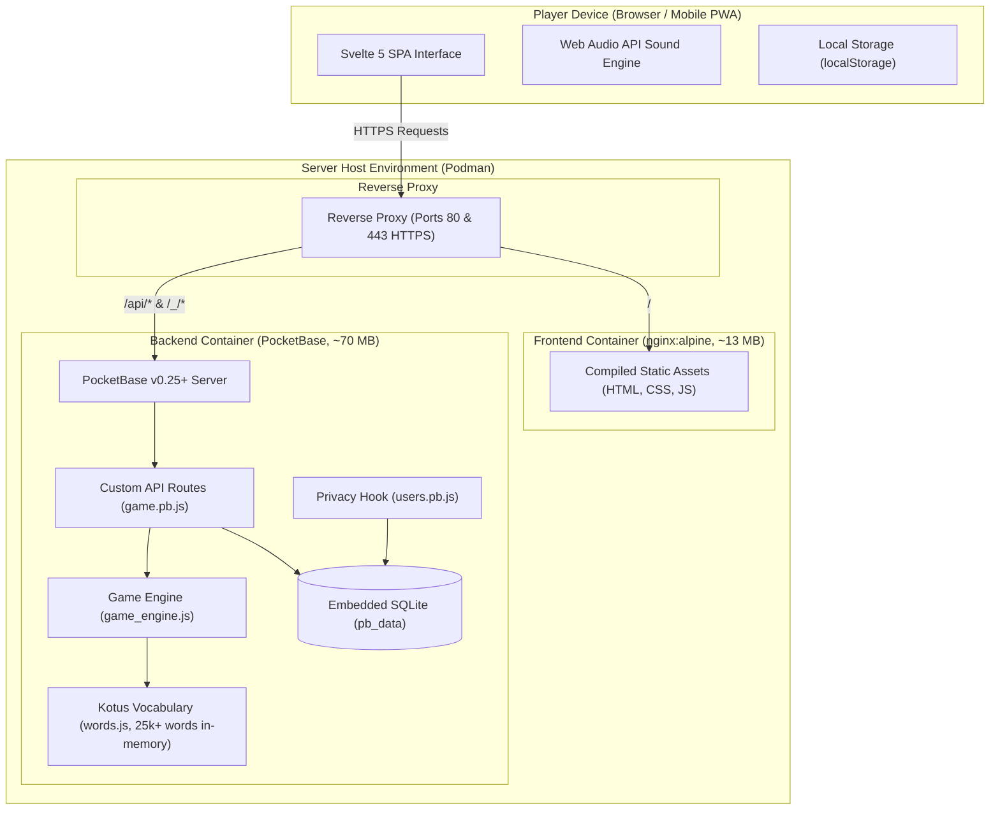

# 🏛 Sanakuutio - System Architecture

This document describes the system architecture, component boundaries, data models, network topology, and privacy design of **Sanakuutio**.

---

## 1. Overview and Core Principles

Sanakuutio is a Finnish Wordle-style word game designed for lightweight, reliable hosting on container-based environments and home servers.

### Core Architectural Principles:
1. **Ultra-Low Resource Footprint**: The entire stack (frontend + backend + database) consumes less than **90 MB of RAM**.
2. **Decoupled Client-Server Model**: Frontend and backend run in isolated Podman containers. The backend exposes a standard REST/JSON API, enabling future native mobile clients (React Native, Flutter, Swift) without backend refactoring.
3. **Privacy by Design**: We store zero personally identifiable information (no email addresses, no real names). Google OAuth serves purely as an identity anchor; players are automatically assigned random Finnish animal gamer tags.
4. **Server-Side Game Logic (Anti-Cheat)**: Secret words are strictly kept server-side and never sent to the browser until a game round concludes.

---

## 2. System Architecture Diagram



---

## 3. Component Details

### 3.1 Frontend (`frontend/`)
A responsive, high-performance Single Page Application (SPA):
* **Framework**: **Svelte 5** (Runes-based reactivity: `$state`, `$derived`, `$effect`) bundled with **Vite 8**.
* **Bundle Size**: ~34 KB gzipped JavaScript total, including the PocketBase SDK and reactive state.
* **Key Components**:
  * [`Board.svelte`](frontend/src/lib/components/Board.svelte): Adaptive 4–8 letter word grid with pop, flip, and shake animations.
  * [`Keyboard.svelte`](frontend/src/lib/components/Keyboard.svelte): Full Finnish keyboard layout (`Å`, `Ä`, `Ö`) with evaluation color states.
  * [`ModalAuth.svelte`](frontend/src/lib/components/ModalAuth.svelte): Google OAuth sign-in, profile viewing, and anonymous gamer tag management.
  * [`ModalStats.svelte`](frontend/src/lib/components/ModalStats.svelte): Win rate, streaks, guess distribution chart (1–6), Kielitoimiston sanakirja definition button, and Wordle emoji share feature (🟩🟨⬛).
  * [`ModalSettings.svelte`](frontend/src/lib/components/ModalSettings.svelte): Theme selection (dark/light), high-contrast accessibility mode, and part-of-speech hint toggles.
* **Audio Synthesizer ([`sounds.js`](frontend/src/lib/sounds.js))**: Generates sound effects synthetically via the browser's Web Audio API (0 KB audio file downloads).
* **PWA & Mobile Ready**: Includes [`manifest.json`](frontend/public/manifest.json) enabling full-screen standalone installation on mobile devices.

### 3.2 Backend (`backend/`)
A single-binary **PocketBase** application (Go + Goja JSVM runtime hooks):
* **Why PocketBase over Supabase?**
  * Supabase runs 10–14 containers and consumes 1.5–2 GB RAM at idle.
  * PocketBase runs as a single lightweight binary with embedded SQLite, idling at ~35–70 MB RAM.
* **Finnish Dictionary ([`pb_hooks/words.js`](backend/pb_hooks/words.js))**:
  * Over 25,000 valid Finnish words derived from Kotus and Voikko databases.
  * Loaded into memory sets on startup for $O(1)$ constant-time validation.
* **Wordle Game Logic ([`pb_hooks/game_engine.js`](backend/pb_hooks/game_engine.js))**:
  * Official two-pass letter coloring algorithm (`correct`, `present`, `absent`).
  * Deterministic daily word selection: `SHA-256(date-length-category)` modulo the top common word pool.

---

## 4. API Specification

| Method | Route | Description | Auth Required |
| :--- | :--- | :--- | :--- |
| `GET` | `/health` | Server health check | Public |
| `POST` | `/api/game/new` | Initiates game session (returns `session_id`, length, category) | Optional (resumes daily game if authenticated) |
| `POST` | `/api/game/guess` | Evaluates guess and returns tile statuses. Reveals secret upon game over. | Optional |
| `GET` | `/api/words/check?word=` | Validates whether a word exists in the Finnish dictionary | Public |
| `GET` | `/api/game/stats` | Fetches aggregated player statistics and streaks | Yes (Bearer Token) |
| `*` | `/_/*` | PocketBase Administrative Dashboard | PocketBase Admin |

---

## 5. Data Model & Privacy Design

### 5.1 Database Collections (SQLite)

#### `users` (System Collection)
* `id`: Unique user UUID
* `username`: Gamer handle (e.g. `Kettu412`, editable by player)
* `email`: Hidden from public API queries (`emailVisibility = false`)

#### `games`
Stores game sessions, active state, and historical records:
* `session_id`: Unique 24-character session key
* `user`: Relation -> `users` (null for guest players)
* `mode`: `"daily"` or `"random"`
* `date_str`: Date string `"YYYY-MM-DD"`
* `length`: Word length (4–8)
* `category`: Part of speech (`"all"`, `"substantiivi"`, `"adjektiivi"`, `"verbi"`)
* `secret`: Hidden target word (secured from client inspection)
* `guesses_json`: Serialized JSON array of guesses and evaluation arrays
* `attempts`: Number of guesses made (0–6)
* `won`: Boolean
* `finished`: Boolean

#### `friendships`
Player social connections for daily challenge comparisons:
* `user_a`: Relation -> `users`
* `user_b`: Relation -> `users`
* `status`: `"pending"` or `"accepted"`

### 5.2 Privacy Architecture (OAuth Privacy Hook)
In [`backend/pb_hooks/users.pb.js`](backend/pb_hooks/users.pb.js), the user registration lifecycle hook ensures:
1. Google's real name is stripped (`name = ""`).
2. Email visibility is forced to private (`emailVisibility = false`).
3. If no username is provided, a randomized Finnish animal gamer tag is generated (`Kettu`, `Ilves`, `Karhu`, `Susi`, `Ahma`, `Norppa`, `Hirvi`, `Metso`, `Kuukkeli`, `Siili`, `Saukko`, `Pöllö` + 3-digit random number).
4. Players can change their gamer tag at any time in their profile settings.

---

## 6. Production Deployment & Reverse Proxy

In production, an SSL-terminating reverse proxy (such as **Caddy** or **Nginx**) is placed in front of the application to handle automated HTTPS on port 443:

```
[ Player Browser / Mobile Client ]
            │  HTTPS (443)
            ▼
[ Reverse Proxy (e.g. Caddy / Nginx) ]
      ├── /api/* & /_/*  ──> Backend Container (PocketBase :8090)
      └── /              ──> Frontend Container (Nginx :80)
```

### Example Caddyfile Configuration:
Caddy automatically provisions and renews Let's Encrypt SSL/TLS certificates:

```caddy
{$DOMAIN_NAME:sanakuutio.example.com} {
    # Route API and Admin Dashboard to PocketBase
    handle /api/* {
        reverse_proxy backend:8090
    }
    handle /_/* {
        reverse_proxy backend:8090
    }

    # Route all other traffic to Frontend SPA
    handle {
        reverse_proxy frontend:80
    }
}
```

---

## 7. CI/CD Automation (GitHub Actions)

Automated continuous deployment workflow:
1. **GitHub Actions Workflow**:
   * Pushes to `main` trigger a container build job.
   * Container images are published to GitHub Container Registry (`ghcr.io/username/sanakuutio-frontend:latest` and `backend:latest`).
2. **Production Deployment**:
   * **Self-hosted GitHub Runner (Recommended)**: A runner inside the production VM connects outbound to GitHub, pulls the latest images from `ghcr.io`, and executes `podman-compose -f compose.prod.yaml up -d`.
   * **Alternative (Watchtower)**: A background daemon monitoring image tags for automated redeployment.
